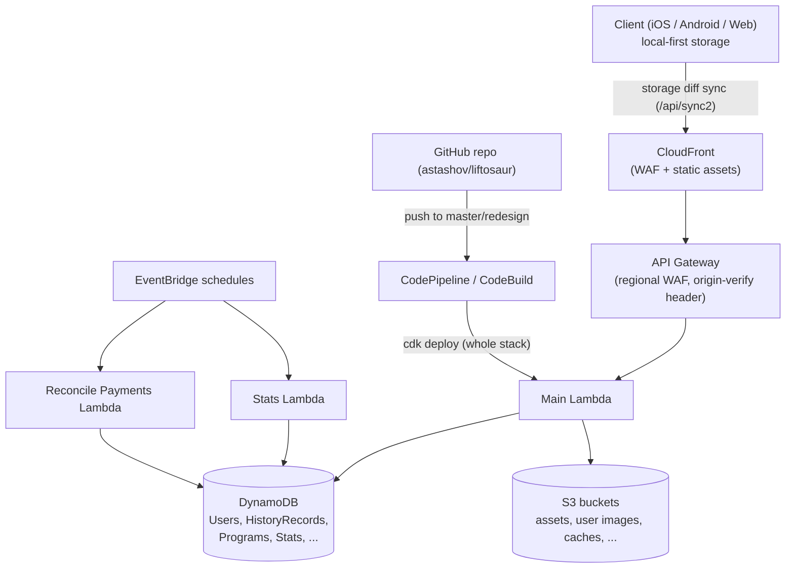
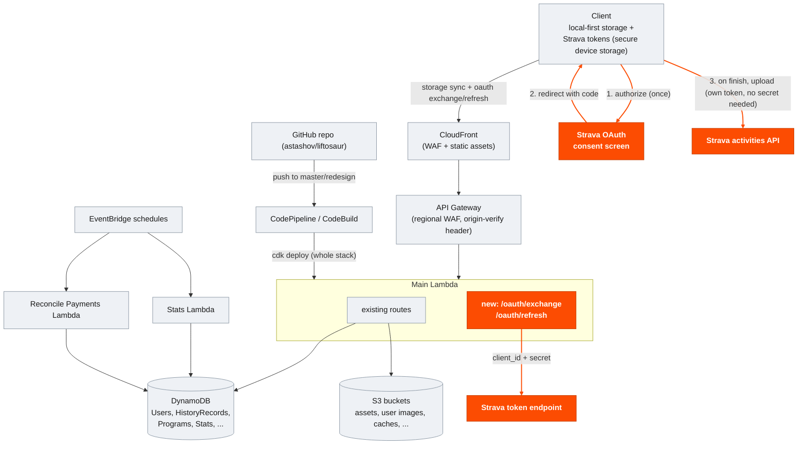

# Proposal: Automatic Liftosaur → Strava Sync

This is a plan for adding automatic Strava sync as a built-in Liftosaur feature (connect once, every finished workout posts to Strava automatically). The goal of this document is to show what could be built and tested independently first, and describe what you'd have to do afterward.

## What it does

- User connects their Strava account from within Liftosaur, once.
- Every workout they finish afterward posts to their own Strava feed
  automatically, no manual export step.
- Credentials are stored per-device, not centrally on your servers.

## Architecture

### Current

This is my current understanding of your architecture, from reading the CDK stack and the client sync code — flag anything that's off.



The client keeps its own local copy of everything (programs, history, stats) and syncs a diff up to the Lambda via `/api/sync2`, which is the only thing that talks to DynamoDB and S3. A CodePipeline, triggered by pushes to `master` (prod) or `redesign` (dev), runs `cdk deploy` on the whole stack — Lambda code, the static site to S3, and (for prod) a separate WAF stack — not just the Lambda in isolation.

### With Strava sync added



Everything grey is today's architecture, unchanged. Everything orange is new.

- The OAuth exchange/refresh calls travel through the exact same CloudFront → API Gateway → Lambda path as everything else — they just land on two new routes inside that Lambda, not a separate service.
- Only the consent screen and the final upload to Strava go directly from the client to Strava, bypassing your infra entirely — neither of those needs the secret.
- One Strava API application represents "Liftosaur." Its `client_id` and `client_secret` never reach the client app.
- The two new routes do exactly two things: exchange an OAuth `code` for tokens, and refresh an expired `access_token`. They never store tokens, only relay them once.
- The two new routes require an authenticated Liftosaur session — the same auth already gating `/api/sync2` — not open endpoints.
- Everything else — which user, which workout, calling Strava's upload API — happens on the user's device, using their own token. Each user's Strava connection is fully independent of every other user's.

## What I can build and test

- A separate dev Strava application (my own developer account, my own callback domain) — nothing about this touches your infra or Strava identity.

- The OAuth relay (two routes), written so the Strava app credentials are config, not code — pointing it at a different Strava app later is a config change, not a rewrite.

  **Exchange the OAuth code for tokens** (holds the secret, called once per connect)

  ```ts
  // POST /oauth/exchange  { code: string }
  // Requires an authenticated Liftosaur session (same auth as /api/sync2)
  async function exchangeHandler(code: string) {
    const res = await fetch("https://www.strava.com/oauth/token", {
      method: "POST",
      headers: { "Content-Type": "application/json" },
      body: JSON.stringify({
        client_id: STRAVA_CLIENT_ID,
        client_secret: STRAVA_CLIENT_SECRET,
        code,
        grant_type: "authorization_code",
      }),
    });
    const { access_token, refresh_token, expires_at } = await res.json();
    return { access_token, refresh_token, expires_at }; // handed back, never stored here
  }
  ```

  **Refresh an expired access token** (same shape, called whenever a client's token has expired)

  ```ts
  // POST /oauth/refresh  { refresh_token: string }
  // Requires an authenticated Liftosaur session (same auth as /api/sync2)
  async function refreshHandler(refreshToken: string) {
    const res = await fetch("https://www.strava.com/oauth/token", {
      method: "POST",
      headers: { "Content-Type": "application/json" },
      body: JSON.stringify({
        client_id: STRAVA_CLIENT_ID,
        client_secret: STRAVA_CLIENT_SECRET,
        refresh_token: refreshToken,
        grant_type: "refresh_token",
      }),
    });
    return res.json(); // { access_token, refresh_token, expires_at }
  }
  ```

- The client-side feature: connect screen, per-device token storage (native only — see the web gap noted below), sync-on-finish, refresh handling, disconnect flow — built to Strava's API brand guidelines (connect button style, required attribution) so it doesn't need rework at review time.

  **Connect once, then sync on every finish** (no Strava app secret involved, only the user's own token; relay calls carry the same Liftosaur session auth `/api/sync2` already uses)

  ```ts
  // 1. Send the user to Strava's consent screen
  const authorizeUrl =
    `https://www.strava.com/oauth/authorize?client_id=${STRAVA_CLIENT_ID}` +
    `&redirect_uri=${REDIRECT_URI}&response_type=code&scope=activity:write`;

  // 2. After the redirect back with ?code=..., trade it for tokens via the relay
  // Same auth as every other endpoint in src/api/service.ts: session cookie,
  // not a bearer header — there's no liftosaurSessionToken variable in this app.
  const { access_token, refresh_token, expires_at } = await fetch(
    `${RELAY_URL}/oauth/exchange`,
    {
      method: "POST",
      credentials: "include",
      body: JSON.stringify({ code }),
    },
  ).then((r) => r.json());
  // Native: new wrapper following the same pattern as
  // src/utils/keychainStore.native.ts's KeychainStore_setAuthToken — its own
  // service constant and single-purpose functions, not a generic key/value
  // store (that file only ever stores one IAuthToken, under one fixed
  // Keychain service/account).
  await KeychainStore_setStravaToken({ access_token, refresh_token, expires_at });

  // 3. On workout finish: refresh first if the stored token's expired, then upload
  async function syncToStrava(workout: FinishedWorkout) {
    let { access_token, refresh_token, expires_at } = await KeychainStore_getStravaToken();
    if (Date.now() / 1000 >= expires_at) {
      const refreshed = await fetch(`${RELAY_URL}/oauth/refresh`, {
        method: "POST",
        credentials: "include",
        body: JSON.stringify({ refresh_token }),
      }).then((r) => r.json());
      ({ access_token, refresh_token, expires_at } = refreshed);
      await KeychainStore_setStravaToken(refreshed);
    }
    await fetch("https://www.strava.com/api/v3/activities", {
      method: "POST",
      headers: {
        Authorization: `Bearer ${access_token}`,
        "Content-Type": "application/json",
      },
      body: JSON.stringify(toStravaActivity(workout)),
    });
  }
  ```

- Testing on my own Strava account(s): connect, refresh, disconnect, revoke, offline retry, duplicate-sync prevention (see below). As of Strava's June 2026 developer program changes, a new app now gets self-serve access for up to 10 athletes with no review — so multi-account isolation (does account A's token ever leak into account B's request) can be tested against 2-3 real throwaway Strava accounts, not just mocked token pairs, without needing any approval from Strava.
- **Duplicate-sync prevention**: `external_id` only applies to Strava's file-upload pipeline, not the manual `POST /api/v3/activities` endpoint this design uses — resending a workout through that endpoint creates a second activity, not a no-op. Dedup needs to be tracked client-side instead: once a workout's upload succeeds, store its returned Strava activity id against the local workout record, and skip re-sending anything already marked synced (with a way to tell "request never reached Strava" apart from "request succeeded but the response was lost," so retries after a dropped connection don't double-post).

None of this would require anything from you. Before I hand it over, the OAuth cycle and isolation logic would already be proven live, against real (throwaway) Strava accounts — not just the production app identity and anything beyond 10 users, which is what actually needs you.

## What you would do after

1. **Register the production "Liftosaur" application** on Strava — a few minutes, under your own developer account. This is the app identity users actually connect to, so it needs to be yours. This is also where the subscription requirement in Known risks applies — worth deciding on that before this step.
2. **Submit for review to go beyond 10 athletes**, whenever you're ready to open this up past a handful of testers. I'll hand you the full request text (description, scopes, screenshots from the already-working dev flow), but it's a real review on Strava's side, not a formality — see Known risks for what to expect on timeline.
3. **Add the relay to your Lambda.** I'll hand you the two routes already written and tested, plus one new secret to add to your existing Secrets Manager bundle.
4. **Review and merge the client-side PR.** Connect screen, token storage, sync-on-finish — already tested against the dev app before you see it. Scoped to native (iOS/Android) for v1 — see Known risks on web.

After that, everything runs on your own infrastructure — nothing would depend on anything I continue to run.

## Security notes

- The Strava app secret never leaves the relay; it's never sent to or stored on the client.
- The relay sees each user's token briefly, only to hand it back to their device — it doesn't log or persist tokens.
- Tokens are stored in device secure storage (Keychain/Keystore), not browser local storage.
- **Multi-device caveat**: Strava rotates the refresh token on every use, and tokens are stored per-device (matching how Liftosaur's own storage sync already treats each device as independent). If a user connects Strava on two devices, one device refreshing its token will invalidate the other device's stored refresh token. In that case the other device's next sync attempt fails and prompts a reconnect — it doesn't lose or corrupt any workout data, but it's a real rough edge worth flagging rather than discovering after launch.

## Known risks

- **Strava now requires an active paid Strava subscription (~$11.99/mo) to hold Standard Tier API access**, as of its June 2026 developer program overhaul. This isn't a one-time fee — it's a recurring cost you'd carry indefinitely to keep the feature working, tied to whichever account registers the app. Worth deciding on before any code changes hands.
- **Athlete capacity above 10 requires a formal review, not a quick request.** Strava's self-serve tier now covers up to 10 athletes with no review at all — enough for us to build and test against real accounts. Beyond that, going to Standard Tier's full range (up to ~9,999) or Extended Access needs Strava's approval, and current developer reports describe that review taking weeks to months with inconsistent responses — Strava explicitly doesn't guarantee a timeline or an outcome. So the honest sequencing is: we can have a fully working, tested feature capped at 10 real users quickly; going beyond that is gated on a Strava review neither of us controls.
- Strava also restricts apps that route data through third-party intermediary platforms as of the same overhaul (API Policy §5.16). This design's shape — OAuth exchange/refresh on your own Lambda, uploads sent straight from each user's device with their own token — reads to me like a direct integration rather than an intermediary, but that's my read, not a ruling; worth going over §5.16 yourself before relying on it.
- Strava's rate limits apply per application, shared across all users once live, and the exact figures have changed more than once this year — worth confirming current numbers from the API settings dashboard at build time rather than assuming any figure stays fixed.
- **No secure token storage on web today.** Native has `react-native-keychain` wired up via `src/utils/keychainStore.native.ts`; the web build's `keychainStore.ts` is currently a no-op stub, so there's nothing to reuse there for Strava tokens. Options are a session-backed store on your Lambda, or browser storage with weaker guarantees than Keychain/Keystore — worth deciding together before I build a web path, rather than me picking one. Scoping v1 to native-only sidesteps the question entirely, if that's preferable.

Happy to walk through any of this in more detail, or start with whichever piece is most useful to see working first.
